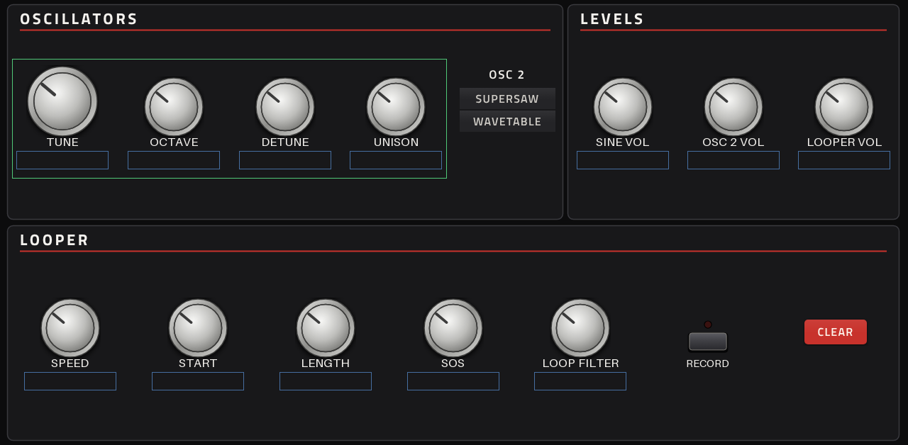
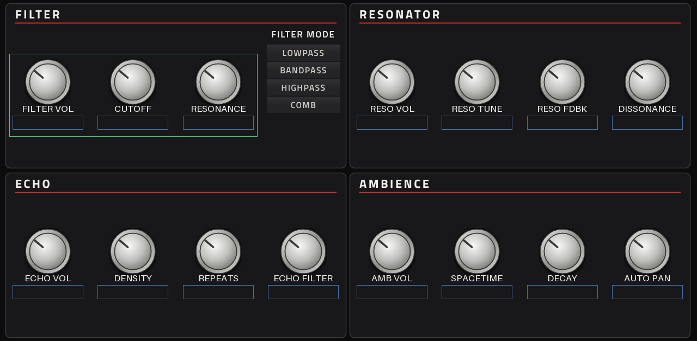
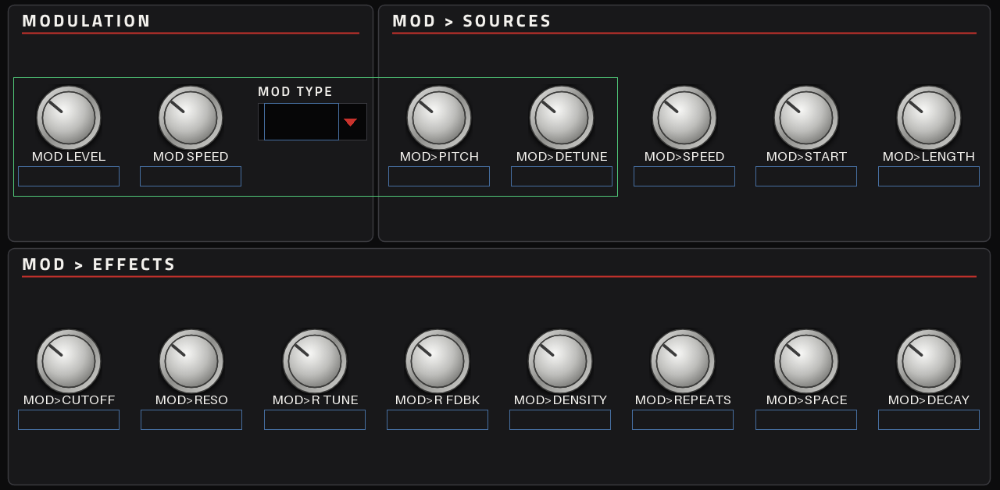
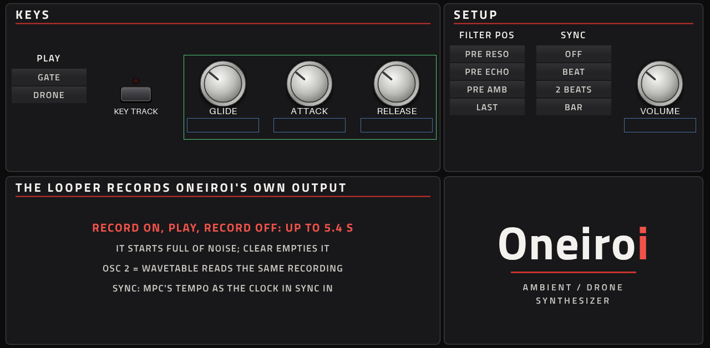

# Oneiroi

**Instrument** · Befaco Oneiroi: Ambient- und Drone-Synth mit Sinus-Oszillator, Supersaw oder Wavetable, Looper, Filter, Resonator, Echo, Hall („Ambience") und einem Modulator · Hersteller in der Force: Befaco · Lizenz: GPL-3.0-or-later

Der Klang ist der Original-Code des Hardware-Moduls (der OWL-Patch von Roberto Noris, Version 1.2.2) samt den benötigten Teilen der OWL-Bibliothek von Rebel Technology. Er läuft wie im Modul mit 48 kHz in 32er-Blöcken und wird auf die 44,1 kHz der Force umgerechnet. Die Bedienlogik des Moduls (Knöpfe mit Shift-Ebenen, Kalibrierung, LEDs) ist ersetzt: Jeder Knopf, jede Shift-Funktion und jede Mod-Stärke ist hier ein eigener Parameter.

## In der Force

- Plugin-Browser: **[SYN] Oneiroi** von **Befaco**
- Dateien: `/sdcard/vst/oneiroi.so`, Bildschirm in `/sdcard/Synths/Befaco - VST - [SYN] Oneiroi/`
- 55 Parameter auf 4 Seiten, 16 Presets im PRESET-Menü
- Auf den Q-Links liegen nur Regler, Schalter bleiben auf dem Touchscreen

## Seiten

| Seite | Inhalt |
|---|---|
| ONEIROI | Oszillatoren (TUNE ±6 Halbtöne, OCTAVE, DETUNE, UNISON, OSC 2 = Supersaw oder Wavetable), die drei Pegel, der Looper (SPEED −2 bis +2, START, LENGTH, SOS, LOOP FILTER, RECORD, CLEAR) |
| EFFECTS | FILTER (Pegel, CUTOFF, RESONANCE, Modus), RESONATOR (Pegel, TUNE, Feedback, DISSONANCE), ECHO (Pegel, DENSITY, REPEATS, Filter), AMBIENCE (Pegel, SPACETIME, DECAY, AUTO PAN) |
| MOD | Modulator (LEVEL, SPEED, TYPE: Chaos, Sinus, Rampe, Säge, Rechteck, Zufall, Hüllkurve) und je eine Stärke für 13 Ziele |
| PLAY | PLAY, KEY TRACK, GLIDE, ATTACK, RELEASE, Filterposition in der Effektkette, SYNC, VOLUME |

  

## Spielen

- **PLAY = GATE**: Die beiden Oszillatoren klingen, solange eine Note gehalten wird (ATTACK und RELEASE von 1 ms bis 8 s). Echo und Hall klingen danach aus, der Looper läuft unabhängig weiter.
- **PLAY = DRONE**: Die Oszillatoren klingen dauernd, wie am Modul.
- **KEY TRACK**: Die gespielte Note verschiebt die Tonhöhe. Bei OCTAVE 4 und TUNE 0 spielt jede Note ihre eigene Tonhöhe (C3 = Grundstellung). GLIDE gleitet, Pitch Bend ±2 Halbtöne.

## Looper

Ein Instrument hat in der Force keinen Audioeingang. Der Looper nimmt deshalb immer Oneirois eigenen Ausgang auf (am Modul die Stellung RESAMPLE). RECORD an, spielen, RECORD aus: bis 5,4 Sekunden. Der Puffer ist beim Laden mit Rauschen gefüllt, wie am Modul; CLEAR leert ihn. OSC 2 = WAVETABLE liest dieselbe Aufnahme als Wellenform. Die Aufnahme wird nicht mit dem Projekt gespeichert.

## SYNC

OFF ist der interne Takt des Moduls (der Looper-Durchlauf). BEAT, 2 BEATS und BAR legen das Tempo der Force als Clock an den SYNC-Eingang, ausgerichtet an der Songposition. Echo, Modulator und Auto Pan folgen dann diesem Takt, und der Looper startet bei jedem Impuls neu, wie am Modul mit Kabel. Das Modul verwirft eine Clock, die langsamer als 2 Sekunden ist; ein längerer Abstand wird deshalb halbiert (BAR unter 126 BPM wird zu 2 BEATS).

## Varianten mit Audioeingang

Dieselbe Engine gibt es mit dem Audioeingang des Moduls als Insert-Effekt: `../vst-fx` (Oneiroi FX, mit eigenem MIDI-Eingang). Er hat zusätzlich IN VOL und LOOP SOURCE; die Parameternummern dieses Instruments bleiben unverändert.

## Unterschiede zum Modul

- Kein Audioeingang und kein Eingangsfader, keine CV-Eingänge.
- Kein RANDOM-Taster mit seinen Schaltern (dafür Presets), keine am Modul gespeicherten Einstellungen, kein MIDI-Ausgang.
- Die Mod-Stärken sind einpolig (0 bis 100 %), wie in der Grundeinstellung des Moduls.
- Ausgang um 6 dB angehoben, mit weichem Knie vor der Vollaussteuerung.
- Kleine Änderungen am Originalcode (`upstream-changes.diff`): zwei ARMv8-Befehle abschaltbar, das Echo folgt einem geänderten Tempo, zwei Lesezugriffe bleiben im Puffer, und drei Destruktoren geben jetzt allen Speicher frei (am Modul wird der Patch nie entladen, in der Force bei jedem Entfernen von der Spur). Die letzten beiden hat der Stresstest gefunden: Bestimmte Mod-Stärken ließen Resonator und Hall außerhalb ihrer Puffer lesen, was in einem Plugin die Force-Software mitgerissen hätte.

## Stand

Offline-Test bestanden (Host-Test von mpc-vst-plugins, ASan/UBSan). Die Engine ist dieselbe wie in Oneiroi FX, das auf der Force läuft; dieses Instrument selbst ist auf dem Gerät noch nicht getestet.

## Neu bauen

Siehe `../README.md`: GitHub Actions baut bei jedem Push, oder lokal mit `"$MPC_VST/tools/build_port.sh" vst/vst.json`. Presets: `presets.src.json` bearbeiten, dann `python3 vst/make_presets.py`.
